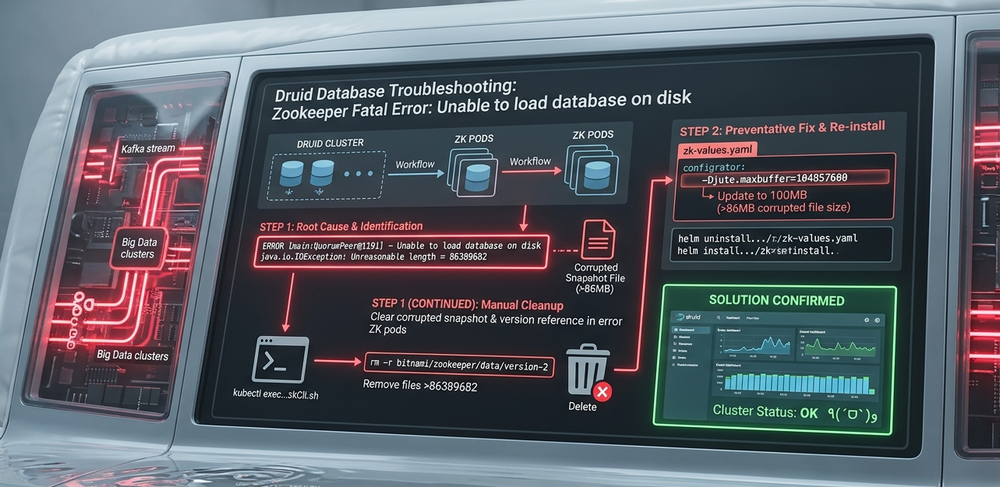

# Druid DB Troubleshooting: Solve the Druid Kafka Zookeeper 'unable to load data base on disk' problem



This article will introduce the detailed steps about how to solve the  'unable to load data base on disk' problem happens in the Druid Database Kafka Zookeeper. 

```python
#Author:      Yuancheng Liu
#Created:     2022/10/12
#Version:     v_0.0.1
#Copyright:   Copyright (c) LiuYuancheng
```

**Table of Contents** 

[TOC]

------

### 1. Background Introduction

Apache Druid is an open-source, distributed data store designed for high-performance real-time analytics. It combines concepts from data warehouses, time-series databases, and search systems, making it a popular choice for large-scale data visualization platforms. In many deployments, Apache Kafka is used as the streaming ingestion pipeline for Druid, enabling continuous data flow into the system.

### 2. Problem Overview

During operation, you may encounter a critical issue in your Druid cluster:

> **ZooKeeper error: “Unable to load database on disk”**

This typically occurs under the following scenario:

- A large volume of streaming data is ingested within a short time window
- One or more data nodes go offline during ingestion
- After recovery, one or more Apache ZooKeeper pods fail to start properly

Even after restarting pods, redeploying ZooKeeper, or reinstalling components, the issue persists. The detail pod error message will be some thing like below:

```
2022-05-08 14:30:34,798 [myid:5] - INFO  [main:ZKAuditProvider@42] - ZooKeeper audit is disabled
2022-05-08 14:30:34,801 [myid:5] - ERROR [main:QuorumPeer@1191] - Unable to load database on disk
java.io.IOException: Unreasonable length = 86389682
	at org.apache.jute.BinaryInputArchive.checkLength(BinaryInputArchive.java:166)
	at org.apache.jute.BinaryInputArchive.readBuffer(BinaryInputArchive.java:127)
	at org.apache.zookeeper.server.persistence.Util.readTxnBytes(Util.java:159)
	at org.apache.zookeeper.server.persistence.FileTxnLog$FileTxnIterator.next(FileTxnLog.java:749)
	at org.apache.zookeeper.server.persistence.FileTxnSnapLog.fastForwardFromEdits(FileTxnSnapLog.java:361)
	at org.apache.zookeeper.server.persistence.FileTxnSnapLog.lambda$restore$0(FileTxnSnapLog.java:267)
	at org.apache.zookeeper.server.persistence.FileTxnSnapLog.restore(FileTxnSnapLog.java:312)
	at org.apache.zookeeper.server.ZKDatabase.loadDataBase(ZKDatabase.java:286)
	at org.apache.zookeeper.server.quorum.QuorumPeer.loadDataBase(QuorumPeer.java:1145)
	at org.apache.zookeeper.server.quorum.QuorumPeer.start(QuorumPeer.java:1130)
	at org.apache.zookeeper.server.quorum.QuorumPeerMain.runFromConfig(QuorumPeerMain.java:229)
	at org.apache.zookeeper.server.quorum.QuorumPeerMain.initializeAndRun(QuorumPeerMain.java:137)
	at org.apache.zookeeper.server.quorum.QuorumPeerMain.main(QuorumPeerMain.java:91)
2022-05-08 14:30:34,803 [myid:5] - ERROR [main:QuorumPeerMain@114] - Unexpected exception, exiting abnormally
java.lang.RuntimeException: Unable to run quorum server 
	at org.apache.zookeeper.server.quorum.QuorumPeer.loadDataBase(QuorumPeer.java:1192)
	at org.apache.zookeeper.server.quorum.QuorumPeer.start(QuorumPeer.java:1130)
	at org.apache.zookeeper.server.quorum.QuorumPeerMain.runFromConfig(QuorumPeerMain.java:229)
	at org.apache.zookeeper.server.quorum.QuorumPeerMain.initializeAndRun(QuorumPeerMain.java:137)
	at org.apache.zookeeper.server.quorum.QuorumPeerMain.main(QuorumPeerMain.java:91).
```


------

### 3. Problem Analysis 

#### 3.1 Root Cause Analysis

This issue is commonly caused by **corrupted or oversized snapshot/transaction log files** in ZooKeeper.

Key contributing factors:

- Druid historical nodes under heavy load request large segment metadata from ZooKeeper
- Corrupted snapshot or transaction logs are generated during node failure
- ZooKeeper persists these snapshots to avoid data loss
- Corrupted snapshots are **propagated back** to healthy or newly created ZooKeeper pods

As a result:

- ZooKeeper pods repeatedly fail during startup
- The cluster may lose quorum (≥50% failure), leading to **complete service disruption**
- Reinstallation alone does not resolve the issue because corrupted data is reintroduced

#### 3.2 Challenges in Manual Cleanup

Manually fixing this problem is difficult because:

- Corrupted files may exist across multiple historical nodes
- Cleanup on one node may trigger replication to another node
- The system continuously attempts to preserve and redistribute snapshot data


------

### 4. Detailed Solution 

To resolve the issue effectively, two actions are required:

1. **Remove corrupted ZooKeeper snapshot files and version references**
2. **Increase the ZooKeeper buffer size (`Djute.maxbuffer`)**

#### 4.1 Step 1: Clear Corrupted Snapshots in ZooKeeper Pods

1. Access the ZooKeeper CLI:

```
kubectl exec -it druid-cluster-zk-zookeeper-<error-index> -- zkCli.sh
```

1. Restart the affected ZooKeeper pod
   - If the pod is stuck in a waiting state, restart it and perform the cleanup during initialization
2. Remove corrupted data files:

```
rm -r /bitnami/zookeeper/data/version-2
```

1. Delete oversized snapshot files:

- Identify snapshot files exceeding the size reported in the error (e.g., `86389682`)
- Remove those files manually:

```
rm snapshot.*
```

✅ At this point, ZooKeeper data directories are clean.

> ⚠️ Important: If you skip this step, corrupted snapshots may be reloaded after reinstallation.


#### 4.2 Step 2: Increase ZooKeeper Buffer Size

Update the ZooKeeper configuration (`zk-values.yaml`) to increase the maximum buffer size:

```
## Log level for the Zookeeper server. ERROR by default. Have in mind if you set it to INFO or WARN the ReadinessProve will produce a lot of logs
##
logLevel: INFO

## Data log directory. Specifying this option will direct zookeeper to write the transaction log to the dataLogDir rather than the dataDir.
## This allows a dedicated log device to be used, and helps avoid competition between logging and snaphots.
## Example:
## dataLogDir: /bitnami/zookeeper/dataLog
##
dataLogDir: ''

## Default JVMFLAGS for the ZooKeeper process
##
-Djute.maxbuffer=104857600	# update to 100MB which is bigger than the error message '86389682', default is 10MB .
```

- Example: Set to **100MB**, larger than the corrupted snapshot size (~86MB)
- Default value is typically **10MB**, which is insufficient in this case

#### 4.3 Step 3: Reinstall ZooKeeper

Uninstall existing ZooKeeper deployment:

```
helm uninstall -n druid druid-cluster-zk
```

Reinstall with updated configuration:

```
helm install -n druid druid-cluster-zk bitnami/zookeeper -f zk-values.yaml
```

Wait all zookeepers online, you druid database will work as usual and you can check the data in your druid dashboard. ٩(ˊᗜˋ )و

Hope this can help you. ~(～￣▽￣)～


Reference: https://www.linkedin.com/pulse/druid-database-troubleshooting-how-solve-zookeeper-unable-liu


------

> Last edit by LiuYuancheng (liu_yuan_cheng@hotmail.com) at 13/04/2026, if you have any problem, please send me a message. 